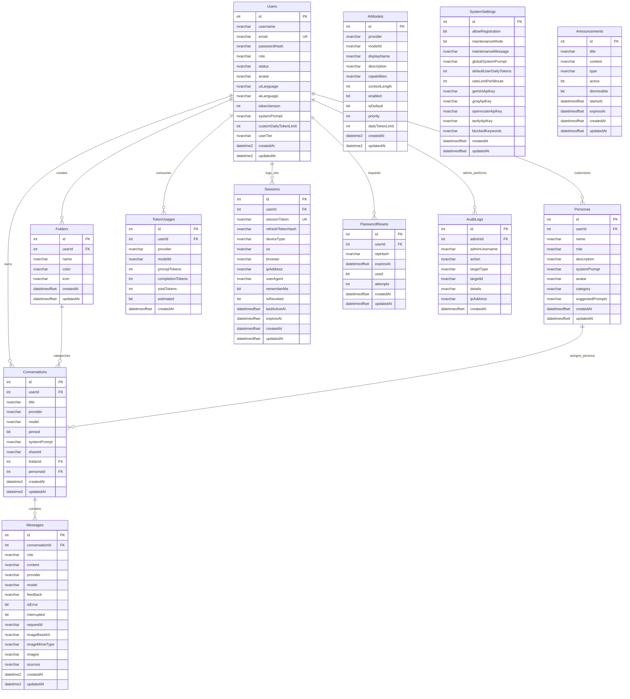

# 🗄️ Tài Liệu Cơ Sở Dữ Liệu Chat AI (Microsoft SQL Server)

Tài liệu chi tiết về cấu trúc cơ sở dữ liệu của dự án Chat AI trên hệ quản trị cơ sở dữ liệu **Microsoft SQL Server (2019/2022/Azure SQL)**. CSDL gồm **12 bảng chuẩn hóa**, hỗ trợ đầy đủ các tính năng hội thoại AI đa mô hình, quản lý phiên đăng nhập, phân quyền, kiểm toán và hạn mức token theo chu kỳ.

---

## 1. Sơ Đồ Quan Hệ Thực Thể (ERD)

---

## 2. Chi Tiết Danh Mục Bảng & Cột

### 2.1. `Users` – Người dùng & Quản trị viên
| Tên cột | Kiểu dữ liệu | Null | Mặc định | Mô tả |
|---|---|:---:|---|---|
| `id` | `INT IDENTITY(1,1)` | ❌ | - | Khóa chính tự tăng |
| `username` | `NVARCHAR(32)` | ❌ | - | Tên hiển thị người dùng |
| `email` | `NVARCHAR(255)` | ❌ | - | Email đăng nhập (Duy nhất - `UQ_Users_email`) |
| `passwordHash` | `NVARCHAR(255)` | ❌ | - | Mật khẩu băm Bcrypt an toàn |
| `role` | `NVARCHAR(10)` | ❌ | `'user'` | Phân quyền: `'user'` hoặc `'admin'` |
| `status` | `NVARCHAR(10)` | ❌ | `'active'` | Trạng thái: `'active'` hoặc `'banned'` |
| `avatar` | `NVARCHAR(500)` | ✔️ | `''` | Đường dẫn hoặc SVG/Dicebear avatar |
| `uiLanguage` | `NVARCHAR(10)` | ✔️ | `NULL` | Ngôn ngữ giao diện người dùng chọn (`vi`, `en`, `es`, `ja`, `zh-CN`) |
| `aiLanguage` | `NVARCHAR(10)` | ❌ | `'auto'` | Ngôn ngữ ưu tiên khi AI trả lời (`auto`, `vi`, `en`...) |
| `tokenVersion` | `INT` | ❌ | `0` | Số phiên bản token để thu hồi JWT cũ khi đổi mật khẩu |
| `systemPrompt` | `NVARCHAR(2000)` | ✔️ | `NULL` | Chỉ dẫn hệ thống cá nhân hóa cho tài khoản |
| `customDailyTokenLimit`| `INT` | ✔️ | `NULL` | Hạn mức token riêng do Admin cấp (ghi đè hạn mức theo gói) |
| `userTier` | `NVARCHAR(20)` | ❌ | `'free'` | Gói tài khoản: `'free'`, `'plus'`, `'premium'`, `'pro'`, `'vip'` |
| `createdAt` | `DATETIME2` | ❌ | `SYSUTCDATETIME()` | Thời điểm tạo tài khoản (UTC) |
| `updatedAt` | `DATETIME2` | ❌ | `SYSUTCDATETIME()` | Thời điểm cập nhật cuối (UTC) |

---

### 2.2. `AIModels` – Danh mục mô hình AI
| Tên cột | Kiểu dữ liệu | Null | Mặc định | Mô tả |
|---|---|:---:|---|---|
| `id` | `INT IDENTITY(1,1)` | ❌ | - | Khóa chính |
| `provider` | `NVARCHAR(50)` | ❌ | - | Tên nhà cung cấp: `'groq'`, `'gemini'`, `'openrouter'` |
| `modelId` | `NVARCHAR(150)` | ❌ | - | Định danh mô hình (vd: `'gemini-2.5-flash'`) |
| `displayName` | `NVARCHAR(150)` | ❌ | - | Tên hiển thị thân thiện trên UI |
| `description` | `NVARCHAR(500)` | ✔️ | `''` | Mô tả ngắn về tính năng và ưu điểm của mô hình |
| `capabilities` | `NVARCHAR(MAX)` | ❌ | `N'["text"]'` | JSON mảng tính năng: `["text", "vision", "reasoning"]` |
| `contextLength` | `INT` | ❌ | `8192` | Độ dài ngữ cảnh tối đa (token) |
| `enabled` | `BIT` | ❌ | `1` | Trạng thái khả dụng để người dùng chọn |
| `isDefault` | `BIT` | ❌ | `0` | Đánh dấu mô hình mặc định của hệ thống |
| `priority` | `INT` | ❌ | `0` | Thứ tự ưu tiên trong bộ định tuyến AI |
| `dailyTokenLimit`| `INT` | ❌ | `0` | Hạn mức riêng cho model (0 = không giới hạn thêm) |
| `createdAt` | `DATETIME2` | ❌ | `SYSUTCDATETIME()` | Thời gian thêm mô hình |
| `updatedAt` | `DATETIME2` | ❌ | `SYSUTCDATETIME()` | Thời gian cập nhật mô hình |

*Ràng buộc:* `UQ_AIModels_provider_modelId UNIQUE (provider, modelId)`

---

### 2.3. `Conversations` – Cuộc trò chuyện
| Tên cột | Kiểu dữ liệu | Null | Mặc định | Mô tả |
|---|---|:---:|---|---|
| `id` | `INT IDENTITY(1,1)` | ❌ | - | Khóa chính |
| `userId` | `INT` | ❌ | - | FK trỏ đến `Users(id)` (ON DELETE CASCADE) |
| `title` | `NVARCHAR(120)` | ❌ | `N'Cuộc trò chuyện mới'`| Tiêu đề cuộc hội thoại |
| `provider` | `NVARCHAR(50)` | ❌ | `'openrouter'` | Nhà cung cấp AI đang chọn cho hội thoại |
| `model` | `NVARCHAR(150)` | ❌ | `'openrouter/free'` | Mô hình AI đang chọn cho hội thoại |
| `pinned` | `BIT` | ❌ | `0` | Ghim cuộc trò chuyện lên đầu danh sách |
| `systemPrompt` | `NVARCHAR(2000)`| ✔️ | `NULL` | Chỉ dẫn hệ thống riêng cho cuộc trò chuyện |
| `shareId` | `NVARCHAR(50)` | ✔️ | `NULL` | Mã chia sẻ công khai (nếu có) |
| `folderId` | `INT` | ✔️ | `NULL` | FK trỏ đến `Folders(id)` (thư mục phân loại) |
| `personaId` | `INT` | ✔️ | `NULL` | FK trỏ đến `Personas(id)` (trợ lý tùy chọn) |
| `createdAt` | `DATETIME2` | ❌ | `SYSUTCDATETIME()` | Thời điểm tạo cuộc trò chuyện |
| `updatedAt` | `DATETIME2` | ❌ | `SYSUTCDATETIME()` | Thời điểm có tin nhắn mới nhất |

*Chỉ mục Composite:* `IX_Conversations_userId_createdAt (userId ASC, createdAt DESC)`

---

### 2.4. `Messages` – Tin nhắn trò chuyện
| Tên cột | Kiểu dữ liệu | Null | Mặc định | Mô tả |
|---|---|:---:|---|---|
| `id` | `INT IDENTITY(1,1)` | ❌ | - | Khóa chính |
| `conversationId`| `INT` | ❌ | - | FK trỏ đến `Conversations(id)` (ON DELETE CASCADE) |
| `role` | `NVARCHAR(10)` | ❌ | - | Vai trò: `'user'`, `'assistant'`, `'system'` |
| `content` | `NVARCHAR(MAX)` | ❌ | - | Nội dung văn bản (hỗ trợ Markdown, KaTeX, mã nguồn) |
| `provider` | `NVARCHAR(50)` | ✔️ | `NULL` | Nhà cung cấp đã sinh câu trả lời |
| `model` | `NVARCHAR(150)` | ✔️ | `NULL` | Mô hình đã sinh câu trả lời |
| `feedback` | `NVARCHAR(10)` | ✔️ | `NULL` | Đánh giá của user: `'like'` hoặc `'dislike'` |
| `isError` | `BIT` | ❌ | `0` | Đánh dấu phản hồi lỗi từ provider |
| `interrupted` | `BIT` | ❌ | `0` | Đánh dấu người dùng bấm dừng hoặc ngắt kết nối giữa chừng |
| `requestId` | `NVARCHAR(100)` | ✔️ | `NULL` | Mã idempotency duy nhất của client gửi lên |
| `imageBase64` | `NVARCHAR(MAX)` | ✔️ | `NULL` | Chuỗi Base64 ảnh đính kèm (legacy) |
| `imageMimeType` | `NVARCHAR(50)` | ✔️ | `NULL` | Kiểu mime của ảnh đính kèm |
| `images` | `NVARCHAR(MAX)` | ✔️ | `NULL` | Mảng JSON chứa danh sách ảnh đính kèm |
| `sources` | `NVARCHAR(MAX)` | ✔️ | `NULL` | Mảng JSON các nguồn trích dẫn tìm kiếm web (Tavily) |
| `createdAt` | `DATETIME2` | ❌ | `SYSUTCDATETIME()` | Thời điểm tạo tin nhắn |
| `updatedAt` | `DATETIME2` | ❌ | `SYSUTCDATETIME()` | Thời điểm sửa đổi tin nhắn |

*Chỉ mục Composite:* `IX_Messages_conversationId_createdAt (conversationId ASC, createdAt ASC)`  
*Chỉ mục Lọc Duy Nhất (Filtered Unique):* `UQ_Messages_requestId (conversationId, requestId) WHERE requestId IS NOT NULL`

---

### 2.5. `TokenUsages` – Sổ cái hạn mức Token
Tách riêng khỏi bảng `Messages` để việc xóa tin nhắn/hội thoại **không làm mất** lượng token đã sử dụng trong chu kỳ ngày.
| Tên cột | Kiểu dữ liệu | Null | Mặc định | Mô tả |
|---|---|:---:|---|---|
| `id` | `INT IDENTITY(1,1)` | ❌ | - | Khóa chính |
| `userId` | `INT` | ❌ | - | FK trỏ đến `Users(id)` (ON DELETE CASCADE) |
| `provider` | `NVARCHAR(50)` | ❌ | - | Nhà cung cấp AI |
| `modelId` | `NVARCHAR(150)` | ❌ | - | Tên mô hình AI |
| `promptTokens` | `INT` | ❌ | `0` | Số token đầu vào (câu hỏi + ngữ cảnh) |
| `completionTokens` | `INT` | ❌ | `0` | Số token đầu ra do AI sinh |
| `totalTokens` | `INT` | ❌ | `0` | Tổng token tiêu thụ |
| `estimated` | `BIT` | ❌ | `0` | `1` nếu provider không trả token thật (ước lượng theo ký tự) |
| `createdAt` | `DATETIMEOFFSET`| ❌ | `SYSUTCDATETIME()` | Thời điểm ghi nhận (UTC) |

*Chỉ mục Composite Covered:* `IX_TokenUsages_userId_createdAt (userId ASC, createdAt ASC) INCLUDE (totalTokens, promptTokens, completionTokens, provider, modelId)`

---

### 2.6. `Folders` – Thư mục gom nhóm hội thoại
| Tên cột | Kiểu dữ liệu | Null | Mặc định | Mô tả |
|---|---|:---:|---|---|
| `id` | `INT IDENTITY(1,1)` | ❌ | - | Khóa chính |
| `userId` | `INT` | ❌ | - | FK trỏ đến `Users(id)` (ON DELETE CASCADE) |
| `name` | `NVARCHAR(100)` | ❌ | - | Tên thư mục |
| `color` | `NVARCHAR(30)` | ❌ | `N'#6366f1'` | Màu sắc nhận diện trên giao diện |
| `icon` | `NVARCHAR(50)` | ❌ | `N'Folder'` | Tên icon Lucide hiển thị |
| `createdAt` | `DATETIMEOFFSET`| ❌ | `SYSUTCDATETIME()` | Ngày tạo |
| `updatedAt` | `DATETIMEOFFSET`| ❌ | `SYSUTCDATETIME()` | Ngày cập nhật |

---

### 2.7. `Personas` – Trợ lý chuyên gia
| Tên cột | Kiểu dữ liệu | Null | Mặc định | Mô tả |
|---|---|:---:|---|---|
| `id` | `INT IDENTITY(1,1)` | ❌ | - | Khóa chính |
| `userId` | `INT` | ✔️ | `NULL` | FK trỏ đến `Users(id)`. `NULL` là trợ lý mẫu hệ thống |
| `name` | `NVARCHAR(100)` | ❌ | - | Tên nhân vật trợ lý |
| `role` | `NVARCHAR(100)` | ❌ | - | Chức danh / vai trò |
| `description` | `NVARCHAR(255)` | ✔️ | `NULL` | Mô tả ngắn về chuyên môn |
| `systemPrompt` | `NVARCHAR(MAX)` | ❌ | - | Chỉ dẫn phong cách trả lời cho AI |
| `avatar` | `NVARCHAR(255)` | ✔️ | `N'🤖'` | Emoji hoặc icon trợ lý |
| `category` | `NVARCHAR(50)` | ❌ | `N'general'` | Phân loại: `'code'`, `'language'`, `'writing'`, `'business'`... |
| `suggestedPrompts`| `NVARCHAR(MAX)`| ✔️ | `NULL` | Mảng JSON các câu hỏi gợi ý khi bắt đầu chat |
| `createdAt` | `DATETIMEOFFSET`| ❌ | `SYSUTCDATETIME()` | Ngày tạo |
| `updatedAt` | `DATETIMEOFFSET`| ❌ | `SYSUTCDATETIME()` | Ngày cập nhật |

---

### 2.8. `Sessions` – Phiên đăng nhập thiết bị
Quản lý đăng nhập đa thiết bị và cơ chế Refresh Token xoay vòng (rotating refresh tokens).
| Tên cột | Kiểu dữ liệu | Null | Mặc định | Mô tả |
|---|---|:---:|---|---|
| `id` | `INT IDENTITY(1,1)` | ❌ | - | Khóa chính |
| `userId` | `INT` | ❌ | - | FK trỏ đến `Users(id)` (ON DELETE CASCADE) |
| `sessionToken` | `NVARCHAR(64)` | ❌ | - | Token định danh phiên ngẫu nhiên (Duy nhất) |
| `refreshTokenHash`| `NVARCHAR(64)`| ❌ | - | Băm SHA-256 của Refresh Token |
| `deviceType` | `NVARCHAR(20)` | ❌ | `'desktop'` | Loại thiết bị: `'desktop'`, `'mobile'`, `'tablet'` |
| `os` | `NVARCHAR(50)` | ✔️ | `NULL` | Hệ điều hành phát hiện từ User-Agent |
| `browser` | `NVARCHAR(50)` | ✔️ | `NULL` | Tên trình duyệt |
| `ipAddress` | `NVARCHAR(50)` | ✔️ | `NULL` | Địa chỉ IP của client |
| `userAgent` | `NVARCHAR(500)` | ✔️ | `NULL` | Chuỗi User-Agent đầy đủ |
| `rememberMe` | `BIT` | ❌ | `0` | Duy trì phiên dài hạn |
| `isRevoked` | `BIT` | ❌ | `0` | Đánh dấu phiên đã bị thu hồi/đăng xuất |
| `lastActiveAt` | `DATETIMEOFFSET`| ❌ | `SYSUTCDATETIME()` | Lần hoạt động gần nhất |
| `expiresAt` | `DATETIMEOFFSET`| ❌ | - | Thời điểm hết hạn phiên |
| `createdAt` | `DATETIMEOFFSET`| ❌ | `SYSUTCDATETIME()` | Thời điểm đăng nhập |
| `updatedAt` | `DATETIMEOFFSET`| ❌ | `SYSUTCDATETIME()` | Thời điểm làm mới phiên |

---

### 2.9. `SystemSettings` – Cài đặt hệ thống
Lưu trữ duy nhất bản ghi có `id = 1`. Các API key được tự động mã hóa **AES-256-GCM** khi ghi và giải mã khi đọc thông qua model.
| Tên cột | Kiểu dữ liệu | Null | Mặc định | Mô tả |
|---|---|:---:|---|---|
| `id` | `INT` | ❌ | `1` | Khóa chính cố định = 1 |
| `allowRegistration`| `BIT` | ❌ | `1` | Cho phép đăng ký tài khoản mới |
| `maintenanceMode`| `BIT` | ❌ | `0` | Bật/tắt chế độ bảo trì hệ thống |
| `maintenanceMessage`| `NVARCHAR(500)`| ❌ | Tiếng Việt mặc định | Thông báo hiển thị khi bảo trì |
| `globalSystemPrompt`| `NVARCHAR(MAX)`| ✔️ | `N''` | Lời nhắc hệ thống áp dụng toàn server |
| `defaultUserDailyTokens`| `INT` | ❌ | `50000` | Hạn mức token mặc định cho user mới |
| `rateLimitPerMinute`| `INT` | ❌ | `30` | Giới hạn số yêu cầu mỗi phút |
| `geminiApiKey` | `NVARCHAR(255)`| ✔️ | `NULL` | Key Google Gemini mã hóa AES-256-GCM |
| `groqApiKey` | `NVARCHAR(255)`| ✔️ | `NULL` | Key Groq mã hóa AES-256-GCM |
| `openrouterApiKey`| `NVARCHAR(255)`| ✔️ | `NULL` | Key OpenRouter mã hóa AES-256-GCM |
| `tavilyApiKey` | `NVARCHAR(255)`| ✔️ | `NULL` | Key Tavily Search mã hóa AES-256-GCM |
| `blockedKeywords`| `NVARCHAR(MAX)`| ✔️ | `NULL` | Danh sách từ khóa cấm/nhạy cảm (phân cách bởi dấu phẩy) |
| `createdAt` | `DATETIMEOFFSET`| ❌ | `SYSUTCDATETIME()` | Ngày khởi tạo |
| `updatedAt` | `DATETIMEOFFSET`| ❌ | `SYSUTCDATETIME()` | Ngày cập nhật |

---

### 2.10. `Announcements` – Thông báo người dùng
| Tên cột | Kiểu dữ liệu | Null | Mặc định | Mô tả |
|---|---|:---:|---|---|
| `id` | `INT IDENTITY(1,1)` | ❌ | - | Khóa chính |
| `title` | `NVARCHAR(255)` | ❌ | - | Tiêu đề thông báo |
| `content` | `NVARCHAR(MAX)` | ❌ | - | Nội dung Markdown |
| `type` | `NVARCHAR(50)` | ❌ | `'info'` | Loại: `'info'`, `'warning'`, `'success'`, `'promo'` |
| `active` | `BIT` | ❌ | `1` | Đang kích hoạt |
| `dismissible` | `BIT` | ❌ | `1` | Cho phép người dùng bấm ẩn banner |
| `startsAt` | `DATETIMEOFFSET`| ✔️ | `NULL` | Thời điểm bắt đầu hiện |
| `expiresAt` | `DATETIMEOFFSET`| ✔️ | `NULL` | Thời điểm kết thúc |
| `createdAt` | `DATETIMEOFFSET`| ❌ | `SYSUTCDATETIME()` | Ngày tạo |
| `updatedAt` | `DATETIMEOFFSET`| ❌ | `SYSUTCDATETIME()` | Ngày sửa |

---

### 2.11. `PasswordResets` – Yêu cầu đổi mật khẩu
| Tên cột | Kiểu dữ liệu | Null | Mặc định | Mô tả |
|---|---|:---:|---|---|
| `id` | `INT IDENTITY(1,1)` | ❌ | - | Khóa chính |
| `userId` | `INT` | ❌ | - | FK trỏ đến `Users(id)` (ON DELETE CASCADE) |
| `otpHash` | `NVARCHAR(255)` | ❌ | - | Băm SHA-256 của mã OTP 6 chữ số |
| `expiresAt` | `DATETIMEOFFSET`| ❌ | - | Thời điểm hết hạn (mặc định 10 phút) |
| `used` | `BIT` | ❌ | `0` | Đã sử dụng mã thành công |
| `attempts` | `INT` | ❌ | `0` | Số lần nhập sai (khóa sau tối đa 5 lần) |
| `createdAt` | `DATETIMEOFFSET`| ❌ | `SYSUTCDATETIME()` | Thời điểm gửi |
| `updatedAt` | `DATETIMEOFFSET`| ❌ | `SYSUTCDATETIME()` | Thời điểm cập nhật |

---

### 2.12. `AuditLogs` – Nhật ký kiểm toán quản trị
| Tên cột | Kiểu dữ liệu | Null | Mặc định | Mô tả |
|---|---|:---:|---|---|
| `id` | `INT IDENTITY(1,1)` | ❌ | - | Khóa chính |
| `adminId` | `INT` | ✔️ | `NULL` | FK trỏ đến `Users(id)` (ON DELETE SET NULL) |
| `adminUsername` | `NVARCHAR(100)` | ✔️ | `NULL` | Tên admin tại thời điểm thực hiện thao tác |
| `action` | `NVARCHAR(50)` | ❌ | - | Hành động (vd: `'USER_BAN'`, `'ROLE_CHANGE'`, `'MODEL_UPDATE'`) |
| `targetType` | `NVARCHAR(50)` | ✔️ | `NULL` | Đối tượng tác động (vd: `'USER'`, `'MODEL'`, `'SETTING'`) |
| `targetId` | `NVARCHAR(100)` | ✔️ | `NULL` | ID của đối tượng bị tác động |
| `details` | `NVARCHAR(MAX)` | ✔️ | `NULL` | Chi tiết thay đổi dạng JSON |
| `ipAddress` | `NVARCHAR(100)` | ✔️ | `NULL` | Địa chỉ IP của quản trị viên |
| `createdAt` | `DATETIMEOFFSET`| ❌ | `SYSUTCDATETIME()` | Thời điểm thực hiện (UTC) |

---

## 3. Quy Tắc Khóa Ứng Dụng & Concurrency
Hệ thống sử dụng cơ chế **SQL Server Application Lock** (`sp_getapplock` & `sp_releaseapplock`) trong [`backend/utils/chatLock.js`](file:///c:/chat-ai/backend/utils/chatLock.js):
- **Khóa User:** `chat:user:<userId>` ngăn người dùng gửi nhiều yêu cầu chat song song, tránh race condition hao hụt quota hoặc spam provider.
- **Khóa Hội Thoại:** `chat:conversation:<conversationId>` ngăn tạo tin nhắn trùng hoặc xung đột trạng thái giữa các tab trình duyệt.
- Nếu tài nguyên đang bị khóa, server trả về mã HTTP `409 CHAT_BUSY` kèm header `Retry-After: 3`.
